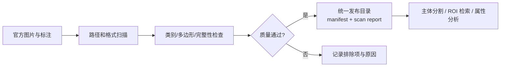

# 模块 3：服饰细粒度语义与分割

模块 3 面向服饰商品的细粒度视觉理解，当前主线聚焦于官方标注数据整理、分割格式转换、数据质量扫描和可复现发布，为主体定位、ROI 检索、细粒度属性分析提供数据基础。

## 当前能力

- 整理 FashionAI 与 DeepFashion 风格的服饰标注数据。
- 统一 JSON / JSONL / COCO 兼容结构。
- 检查图片、标注、类别、路径和多边形一致性。
- 生成 manifest、scan report 与文件哈希，保留排除原因。
- 为模块 2 的主体区域分析和 ROI 检索提供可复用数据接口。

## 数据流程



## 工程入口

| 路径 | 作用 |
| :--- | :--- |
| `src/multimodal_ecommerce/segmentation.py` | 分割数据结构与处理逻辑 |
| `scripts/module3_segmentation_data.py` | 数据准备、转换与检查 |
| `scripts/publish_module3_official.py` | 发布通过扫描的数据版本 |
| `configs/module3_segmentation.json` | 数据版本与处理策略配置 |
| `data/module3_segmentation_official_v1/manifest.json` | 已发布数据清单 |
| `data/module3_segmentation_official_v1/scan_report.json` | 数据扫描结果 |
| `tests/test_segmentation.py` | 模块 3 单元测试 |

## 技术栈

Python 3.12+ · NumPy · Pillow · JSON/JSONL · COCO 标注结构 · pytest · Black · isort · Flake8 · SHA-256 完整性校验

## 运行示例

```bash
python scripts/module3_segmentation_data.py --help
python scripts/publish_module3_official.py --help
python -m pytest -q tests/test_segmentation.py
```

## 当前边界

已完成v2数据发布、Mask R-CNN实例分割入口、项目内AP评测、训练恢复，以及四图CPU/MPS对照。四图学习门槛仍未通过，尚未开展全量训练或正式test推理。

本开发分支：`module3-dev`。


## 最新同步：2026-11-16

- [完整阶段记录](docs/module3_segmentation.md)
- [CPU/MPS实测](artifacts/module3_device_comparison_v1/progress.md)：同四图100步CPU约21.6秒/AP50=62.62%，MPS约150.9秒/AP50=37.62%；不是完整验证集成绩。
- [上传范围与复现边界](docs/module3_git_handoff.md)、[大文件排除与哈希清单](docs/module3_upload_inventory.json)
- 新增入口：`module3_instances.py --device cpu/mps`、`module3_learning.py`、`module3_diagnose.py`、`module3_device_check.py`。

在Python 3.12环境安装 `requirements-module3.txt` 后，模块三核心测试命令：

```bash
python -m pytest -c pytest-module3.ini
```

数据和模型checkpoint保留本地，manifest/审计和小型实验产物已上传。`module3_segmentation.md`中“尚未同步GitHub”均为当时历史状态，本次同步已纳入所列工程进度。
