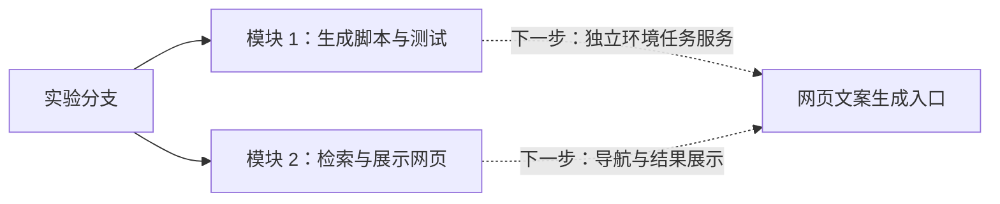

# 模块 1 + 模块 2 · 合并实验

**商品内容生成 × 多模态商品检索**

| 模块 | 已接入内容 | 使用入口 |
|---|---|---|
| 模块 1 | Qwen 文案生成、事实检查、修复、183 项单元测试 | `scripts/test_copywriting_batch.py` |
| 模块 2 | 图搜、文搜、展示网页与原有检索工程 | `scripts/serve_showcase.py` |

本分支合入两个开发分支的代码，以模块 2 为工程基础，保留双方历史为合并提交的两个父提交。模型依赖分别安装；网页新增生成入口尚待下一步开发。



## 无模型检查

```bash
python scripts/test_copywriting_logic.py
```

本次运行 183 项模块 1 测试通过。模型生成需要另行准备 Qwen 权重及生成环境。

[合并实验记录、差异处理与下一步](docs/module12-merge-experiment.md)

[模块 1 原始说明](https://github.com/Zicheng-Xie/E-commerce-Multimodal-Intelligent-Content-and-Retrieval-System/blob/shz-dev/README.md) · [模块 2 完整说明](https://github.com/Zicheng-Xie/E-commerce-Multimodal-Intelligent-Content-and-Retrieval-System/blob/module2-dev/README.md)
