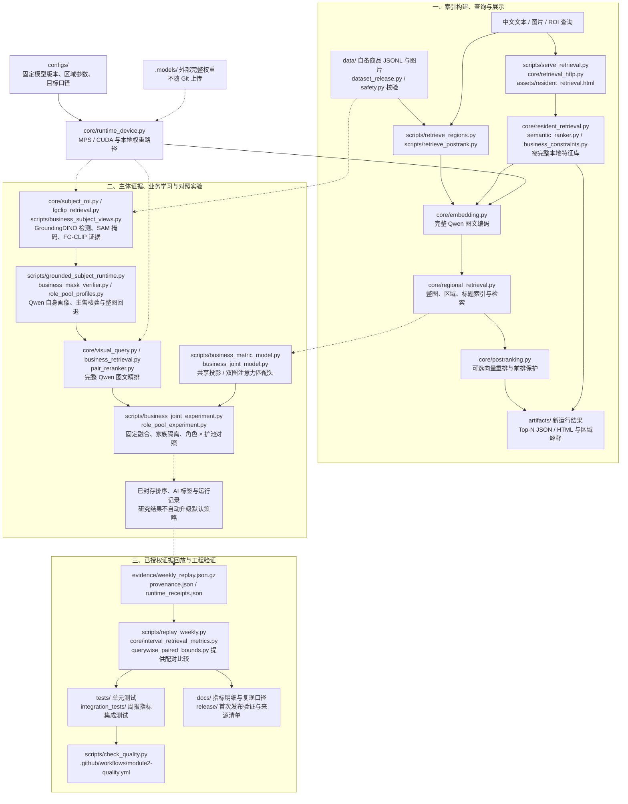

# 模块二：多模态商品检索

面向 **3C 数码、服饰穿搭、家居日用**的电商商品检索模块：接收中文文本或商品图片，将查询与图库映射到统一特征空间，通过区域召回、图文精排及可选业务融合输出 Top-N 商品及匹配解释。

本分支为独立的 `module2-dev`，模块一由 `shz-dev` 维护。当前已完成检索功能、若干业务适配实验及可复核评测；图片分支质量门槛仍未通过，原默认策略保留。以下进展与量化结果对应 **2026.10.19—11.04 双周报及已封存证据**。

## 工程逻辑架构

下图展示主要目录、代码职责与数据流。图中 `core/` 统一指代实际目录 `src/multimodal_ecommerce/`。研究分支为可选对照，不会自动加入默认检索路径；常驻服务需要另备完整本地特征库。



图中实线表示运行或数据依赖，虚线表示可选研究支路或封存证据关联。离线回放从冻结结果重算指标，不重新运行图像模型；当前新 SAM 掩码全局停用。

## 当前技术进展

| 工作方向 | 已完成的进展 | 当前状态与结论 |
|---|---|---|
| 基础多模态检索 | 中文文本 / 图片输入、2048 维共享表征、整图与区域 / 标题检索、ROI 裁切、Top-N 解释 | 功能已跑通；真实模型需外部权重与合法商品图片 |
| 图文精排与主体修复 | 完整 Qwen 精排、整图 / 放大上下文融合、query-only 主售定位与语义回退 | 主售修复完成 22 方法、880 份排序；未整体通过业务目标 |
| 主体视图与质量检查 | 435 张原图审计、412 次完整检测、383 次 SAM 调用；商品 / 查询视图 QA | 检出关键结构缺失和展示道具混入；新掩码不进入默认训练 / 推理 |
| 细粒度与业务学习 | FG-CLIP 2 辅助证据、Multi-Similarity 共享投影、DINOv2 双图匹配头与固定融合 | 双图实验完成 7 方法、280 份排序；OOF 结果仅作开发诊断 |
| 主售角色与候选扩池 | 原池 / 扩池 × 原排序 / 角色排序四组，另保留四种参照 | 完成 8 方法、320 份排序；fresh 的 P/R/mAP/NDCG 严格退步，不采用 |
| 独立数据 AI 验证 | 完成两轮标签先冻结、再预测的 AI 盲测 | 两轮图片 P@10 均未过 60%；数据已 consumed，不复用为新盲测 |
| Mac 迁移与工程交付 | Python 3.12、PyTorch / Transformers、MPS 与路径适配；真实图文编码和精排通过 | 101 项单元测试 + 13 项集成测试通过；首次代码发布的远端 CI 通过 |

## 功能、技术栈与代码位置

| 功能 | 技术栈 / 算法 | 主要代码 | 实现要点 |
|---|---|---|---|
| 统一图文表征 | Qwen3-VL-Embedding-2B、PyTorch、Transformers、NumPy | `core/embedding.py`、`core/retrieval.py` | 完整模型输出 2048 维向量，余弦相似度检索 |
| 区域与属性检索 | 自动候选区域、裁切放大、Softmax 区域注意力、标题与属性证据融合 | `core/regional_retrieval.py`、`query_fusion.py`、`semantic_ranker.py`、`business_constraints.py` | 保留整图分支；属性约束只使用显式输入与自身公开证据 |
| 候选精排 | Qwen3-VL-Reranker-2B、图文联合输入、20/60 候选池、精确身份缓存 | `core/pair_reranker.py`、`business_retrieval.py`、`visual_query.py` | 完整配对评分；缺失模型分数不补零、不猜测 |
| 主体定位与语义核验 | GroundingDINO、SAM 2.1 Base+、Qwen3.5-4B、Ollama | `core/subject_roi.py`；`scripts/grounded_subject_runtime.py`、`business_subject_views.py`、`business_mask_verifier.py` | 主售不明或裁切不可靠时整图回退；掩码受质量门槛约束 |
| 细粒度图文辅助 | FG-CLIP 2 Base，全局 / 密集区域 / 文本特征，最高 5% 有效 patch 聚合 | `core/fgclip_retrieval.py` | 固定权重辅助分支；局部改善不等于整体收益 |
| 整图业务度量学习 | PyTorch、2048→256→256 共享投影、Multi-Similarity 困难样本挖掘 | `scripts/business_metric_model.py`、`business_metric_experiment.py` | 骨干冻结；未知关系不作负例；家族隔离训练 |
| 双图业务适配 | 完整 12 层 DINOv2-small、448×224 联合输入、384 维联合特征与匹配头 | `scripts/business_joint_model.py`、`business_joint_experiment.py` | 所有 512 个 patch 共同注意力；只训练头；借鉴 STIR 思路，不是其论文权重复现 |
| 主售角色与扩池 | 自身角色画像、原候选保留、固定加入双图前 20、whole / zoom 融合 | `scripts/role_pool_profiles.py`、`role_pool_experiment.py` | 四组归因；画像不确定时回退真实原始分数；不按结果调权 |
| 指标与回归 | 六指标未知标签补全界、共享未知标签配对比较、pytest | `core/interval_retrieval_metrics.py`；`scripts/querywise_paired_bounds.py`、`replay_weekly.py` | K=10、完整图库 / 完整排序；不删困难查询，不缩正例分母 |
| 服务与质量门禁 | 本地 HTTP、HTML、MPS / CUDA；Black、isort、flake8、mypy、Pylint、GitHub Actions | `scripts/serve_retrieval.py`、`check_quality.py`；`assets/`、`.github/workflows/` | 常驻服务需完整本地特征库；CI 不加载 GPU 模型 |

上表的 `core/` 路径均相对 `src/multimodal_ecommerce/`；同一单元格后续文件名沿用该目录。仅 `scripts/` 项明确位于脚本目录。

## 关键质量指标

P@10 为硬目标 ≥60%，R@10 为偏好目标 ≥85%；同时查看 mAP、NDCG@10、MRR、Hit@1 的变化。下表全部为 **百分比**；区间表示未知 AI 标签补全下的计算上下界，不是置信区间。两轮独立验证与开发 OOF 数据分别报告。

| 实验 / 分组 / 候选 | P@10 | R@10 | mAP | NDCG@10 | MRR | Hit@1 |
|---|---:|---:|---:|---:|---:|---:|
| 首次 AI 盲测 / 总体 | 63.83–71.00 | 89.06–94.71 | 77.86–87.11 | 80.70–89.40 | 85.00–89.96 | 81.67–86.67 |
| 首次 AI 盲测 / 文本 | 84.33–90.00 | 94.33–97.25 | 95.32–98.44 | 95.90–98.10 | 100.00 | 100.00 |
| 首次 AI 盲测 / 图片 | 43.33–52.00 | 82.73–91.99 | 60.41–75.78 | 65.50–80.70 | 70.00–79.92 | 63.33–73.33 |
| 第二次 AI 盲测 / 总体 | 49.58–54.17 | 89.80–94.86 | 73.14–77.11 | 75.05–77.07 | 75.60–78.03 | 70.83–75.00 |
| 第二次 AI 盲测 / 文本 | 59.17–65.83 | 91.32–91.44 | 84.71–90.16 | 86.73–89.98 | 88.69–92.86 | 83.33–91.67 |
| 第二次 AI 盲测 / 图片 | 40.00–42.50 | 87.78–100.00 | 61.57–64.05 | 63.36–64.17 | 62.50–63.19 | 58.33 |
| 双图融合 / A（tune） | 82.50–91.88 | 39.88–56.89 | 75.90–87.46 | 85.65–95.57 | 100.00 | 100.00 |
| 双图融合 / B（regression） | 71.88–86.88 | 37.94–61.36 | 70.73–89.72 | 75.92–93.32 | 87.50–96.88 | 81.25–93.75 |
| 双图融合 / C（fresh） | 55.00–78.75 | 39.55–56.25 | 47.31–67.84 | 57.44–82.14 | 79.17–100.00 | 62.50–100.00 |
| 角色扩池 / A（tune） | 81.88–90.62 | 38.98–55.61 | 74.43–85.83 | 84.98–93.19 | 96.88 | 93.75 |
| 角色扩池 / B（regression） | 70.62–84.38 | 36.93–60.50 | 68.87–90.32 | 74.33–94.09 | 86.46–100.00 | 81.25–100.00 |
| 角色扩池 / C（fresh） | 43.75–67.50 | 30.04–47.21 | 42.37–60.75 | 50.20–71.12 | 84.38–87.50 | 75.00 |

首次验证为 300 件图库 / 60 查询；第二次为 96 件 / 24 查询。开发 A/B 各 16 查询（8 文本 + 8 图片），C 为 8 图片查询；开发图库各 315 件，fresh 共享 tune 图库。当前开发关系共 12,600 条，不能把不同方法或版本的样本量累加。

**结论：**首次盲测总体 P@10 / R@10 达到目标，但图片 P@10 未达；第二次总体 P 未达、R 偏好通过；角色扩池 fresh 严格退步。人工标签为 0，正式验收指标为 null，默认方法未升级。完整基线、分模态表和对应方法名见 [六指标明细](docs/weekly_metrics.md)。

## 工程规模与性能记录

| 项目 | 量化结果 | 测量或统计口径 |
|---|---|---|
| 精选 Python 工程 | 102 个文件 | 功能、共享依赖、单元与集成测试；不包含旧源码快照 |
| 工程回归 | 101 项单元 + 13 项集成测试通过 | 首次发布已在本地及 GitHub Actions 验证 |
| 指标回放 | 11 组结果、1,756 份完整排序一致 | 180 + 96 两轮盲测、280 双图、320 角色、880 主售修复 |
| 两轮盲测关系 | 18,000 / 2,304 条；59 / 16 项未知 | 原未知项保留为 null，完整图库分母不变 |
| 授权证据 | 32,904 条去重后的 AI 关系，约 252 KB 压缩数据 | 开发标签跨实验复用，相同完整排序只保存一次 |
| 主体模型工作量 | 412 次完整检测、383 次 SAM 调用 | 历史 CUDA 实验运行收据；调用数不是准确率 |
| 双图工作量 | 7,560 个真实配对、1,890 次批前向 | 24 图片查询 × 315 候选；18 个家族折头模型重放 |
| Mac 文本 / 图片嵌入 | 2.422 秒 / 4.288 秒 | 2026-11-01、M4 Pro 48 GiB、MPS；单次完整编码 |
| Mac 单对精排 | 1.544 秒 | 同次冒烟测试，完整 Qwen 精排；不含加载 |

Mac 计时是历史单次推理记录，不是 P50/P95 或端到端服务时延。当前精简版也已通过真实 MPS 图文编码、精排及 Ollama 连接检查；CPU 指标回放与模型性能分开验证。证据见 `evidence/runtime_receipts.json`、`evidence/provenance.json` 与 `release/verification.json`。

## 先运行不需要模型的周报复核

Python 3.12，在当前分支根目录执行：

```bash
python3.12 -m venv .venv
source .venv/bin/activate
python -m pip install -e '.[dev,retrieval]'
python -m pytest -q
python scripts/check_quality.py
```

默认 101 项单元测试只依赖代码和小型夹具；另有 13 项数据集成测试，逐项复核两轮盲测、双图开发、角色扩池及主售修复的六项指标。

本分支包含项目所有者明确授权公开的约 252 KB 精简回放数据。无需模型、GPU 或 Ollama，直接执行：

```bash
python scripts/replay_weekly.py
python -m pytest -q integration_tests
```

11 组结果、1,756 份完整排序已逐项回放一致。两轮盲测均已 consumed，其他组均为曝光开发；不包含新的未消耗盲测材料。

完整工程检查需要 Node.js；CI 使用 Node 22。`check_quality.py` 检查 Black、isort、flake8、mypy、Pylint、PDF 规则与全部测试，有跳过项也会失败。

## 在 Mac / CUDA 上运行真实检索

设置好 Ollama，并另行取得固定版本模型。模型不随 Git 上传：

```bash
python scripts/download_models_mac.py
# Mac Apple Silicon
export MULTIMODAL_DEVICE=mps
# CUDA 机器改用 export MULTIMODAL_DEVICE=cuda
python scripts/retrieve_regions.py --help
python scripts/retrieve_postrank.py --help
```

权重目录为 `.models/<模型仓库名称>/`，revision 与逐文件摘要位于 `configs/`。不静默回退 CPU。Qwen3.5 本地视觉服务用于主体描述/核验，检索嵌入与精排由完整独立模型执行。

使用自己的合法商品图片准备 `data/catalog/products.jsonl`：

```json
{"id":"item_001","text":"原始商品标题","category":"家居日用","attributes":{},"evaluation_eligible":true,"image_path":"images/item_001.jpg","image_sha256":"填写该图片真实的SHA256"}
```

图片路径相对 JSONL 所在目录，需位于该目录内；真实摘要必须匹配。然后构建新索引并查询：

```bash
python scripts/retrieve_regions.py build --dataset data/catalog/products.jsonl --index data/index_regions
python scripts/retrieve_regions.py search --index data/index_regions --text '双层壁挂调料架' --output artifacts/query_text
python scripts/retrieve_regions.py search --index data/index_regions --image data/catalog/images/item_001.jpg --roi 0.1 0.1 0.9 0.9 --output artifacts/query_roi
```

常驻 HTTP、整图业务学习及角色归因的历史实验驱动也保留在 `scripts/`，需要原有完整特征库、数据与冻结协议，不能仅凭代码及周报聚合指标启动。这些源码支持审查和在完整本地工程复现；公开分支的开箱入口是单元测试；历史指标回放可使用本分支已授权的精简证据。未提供新的角色方法在线部署成绩。

## 指标与复现证据索引

- [周报六指标表与代码/测试映射](docs/weekly_metrics.md)
- [证据转换、来源与运行边界](docs/reproduction.md)
- `evidence/provenance.json`：原始文件 SHA256、排序计数和去重变换。
- `integration_tests/test_weekly_replay.py`：完整回放数据的独立集成测试。
- `release/source_manifest.json`：源码选择与打包改动。
- `release/verification.json`：本次精选工程的实际检查结果。

模型回放、单元测试通过不代表检索业务目标通过。OOF 拼接只作开发诊断；两个盲测与开发结果不跨版本合并为迭代增益。

`release/` 保存首个代码发布版本的验证与来源记录；后续 README 文档提交不回写历史收据。
