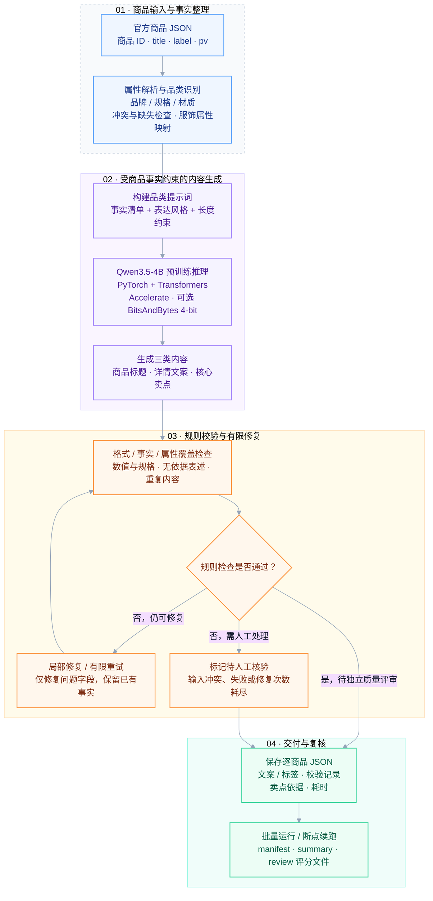
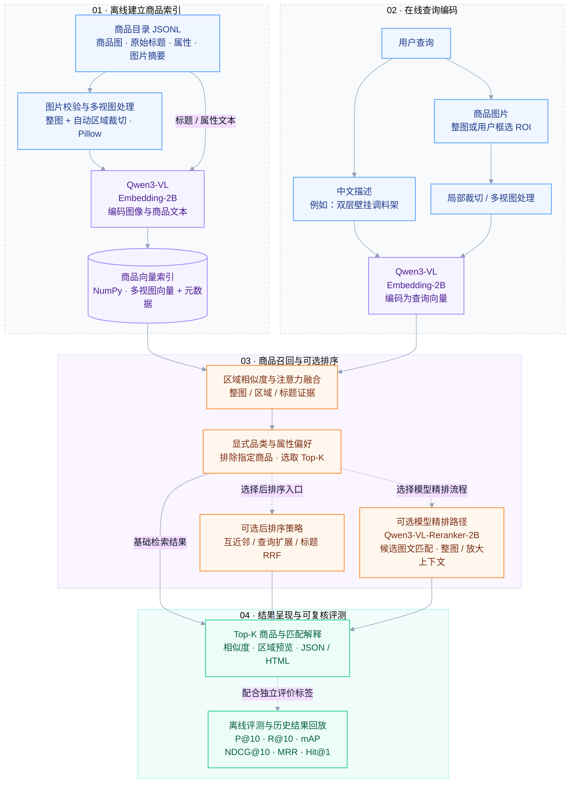

# Multimodal E-commerce

### 电商多模态智能内容与检索系统

**商品属性 → 智能内容生成 ｜ 文本 / 图片 → 相关商品检索**

[模块 1 · 内容生成](#模块-1商品内容智能生成) · [模块 2 · 多模态检索](#模块-2多模态商品检索) · [分支与源码](#分支与源码)

---

## 项目概览

面向电商商品信息处理的 AI 工程：模块 1 将原始商品属性组织成标题、详情与卖点；模块 2 将中文描述或商品图片转化为检索请求，返回相关商品及匹配依据。

| 模块 | 用户可以完成什么 | 核心技术 | 实现分支 |
| :--- | :--- | :--- | :--- |
| **01 · 商品内容智能生成** | 批量生成中文标题、详情文案与核心卖点，校验事实和属性覆盖，支持局部修复与断点续跑 | Qwen3.5-4B · 规则约束 · 提示词工程 · 4-bit 量化 | [`shz-dev`](https://github.com/Zicheng-Xie/E-commerce-Multimodal-Intelligent-Content-and-Retrieval-System/tree/shz-dev) |
| **02 · 多模态商品检索** | 中文搜商品、以图搜商品、框选局部检索，查看排序与区域匹配解释 | Qwen3-VL-Embedding-2B · 多视图融合 · 可选 Qwen3-VL-Reranker-2B 精排 | [`module2-dev`](https://github.com/Zicheng-Xie/E-commerce-Multimodal-Intelligent-Content-and-Retrieval-System/tree/module2-dev) |
| **03 · 细粒度服饰语义理解** | 项目规划模块；本页集中展示前两个分支已提供的实现 | 待独立模块完善 | — |

> `main` 是项目概览入口，两个模块的代码分别维护在开发分支。以下流程图概括各自实现，两个模块目前独立运行。

## 模块 1：商品内容智能生成

**输入商品事实，输出可追溯的中文电商内容。** 面向 3C 数码、服饰穿搭、家居日用，支持自定义表达风格与内容长度。

| 技术层 | 实际使用 | 对应能力 |
| :--- | :--- | :--- |
| 数据与规则 | Python 3.11 · JSON · 商品属性解析与品类规则 | 整理商品事实，映射服饰标签，定位冲突与缺失 |
| 生成模型 | Qwen3.5-4B · PyTorch · Transformers | 根据商品事实生成三类简体中文文案 |
| 推理与资源 | Accelerate · BitsAndBytes（可选 4-bit）· CUDA | 在本地 GPU 执行推理，提供量化选项 |
| 质量与交付 | 格式/事实校验 · 局部修复 · 逐商品记录 · review 文件 | 支持批量生成、续跑、耗时分析及独立质量复核 |

当前为预训练模型推理与规则约束，未进行专门微调；生成链路使用文本属性，图片和视频字段仅保留。服饰标签来自属性映射。规则通过后仍需独立评审，正式验收尚未完成。

**源码入口：** [生成与修复主流程](https://github.com/Zicheng-Xie/E-commerce-Multimodal-Intelligent-Content-and-Retrieval-System/blob/shz-dev/scripts/test_copywriting_batch.py) · [环境与使用说明](https://github.com/Zicheng-Xie/E-commerce-Multimodal-Intelligent-Content-and-Retrieval-System/blob/shz-dev/README.md)

## 模块 2：多模态商品检索

**用中文或图片寻找相关商品，并查看匹配依据。** 支持整图、多区域及 ROI 局部检索；基础区域检索、后排序和模型精排是可选路径，按入口与配置使用。

实线表示主要数据流，虚线表示可选路径或配套评测。图中的排序分支是能力概览，具体组合与输入要求以各入口代码为准。

| 技术层 | 实际使用 | 对应能力与状态 |
| :--- | :--- | :--- |
| 基础工程 | Python 3.12 · NumPy · Pillow · JSONL | 商品目录校验、图像预处理、向量索引与结果导出 |
| 多模态表征 | Qwen3-VL-Embedding-2B · PyTorch · Transformers · qwen-vl-utils | 完整模型编码文本和图片，多视图与 ROI 检索 |
| 排序与解释 | 区域注意力融合 · 互近邻 · 查询扩展 · RRF | 提供可切换的检索/后排序策略与区域证据 |
| 模型精排 | Qwen3-VL-Reranker-2B | 独立候选精排路径，支持完整图文输入及严格分数缓存 |
| 主体与视觉研究 | GroundingDINO · SAM 2.1 · FG-CLIP 2 · Qwen3.5 / Ollama | 主体定位、分割与语义核验适配；新掩码未通过质量检查，保持停用 |
| 业务学习研究 | Multi-Similarity 共享投影 · DINOv2 双图联合注意力与匹配头 | 业务相关性学习、主售/道具识别与角色扩池对照；未替换默认方法 |
| 运行与验证 | Apple MPS / CUDA · 本地 HTTP 开发服务 · pytest · 指标回放 | 支持本地推理与历史结果复核；HTTP 及历史实验还需完整特征库与冻结协议 |

公开分支包含代码、测试和精简回放证据；模型权重、原图与完整特征库需另行准备。主体研究与业务学习路径属于独立实验能力，未作为默认线上流程。当前正式验收尚未完成，历史 AI 标签计算界与回放结果的说明见[周报指标](https://github.com/Zicheng-Xie/E-commerce-Multimodal-Intelligent-Content-and-Retrieval-System/blob/module2-dev/docs/weekly_metrics.md)。

**源码入口：** [索引构建与区域检索](https://github.com/Zicheng-Xie/E-commerce-Multimodal-Intelligent-Content-and-Retrieval-System/blob/module2-dev/scripts/retrieve_regions.py) · [可选后排序](https://github.com/Zicheng-Xie/E-commerce-Multimodal-Intelligent-Content-and-Retrieval-System/blob/module2-dev/scripts/retrieve_postrank.py) · [完整模型精排](https://github.com/Zicheng-Xie/E-commerce-Multimodal-Intelligent-Content-and-Retrieval-System/blob/module2-dev/src/multimodal_ecommerce/pair_reranker.py) · [复现与运行说明](https://github.com/Zicheng-Xie/E-commerce-Multimodal-Intelligent-Content-and-Retrieval-System/blob/module2-dev/README.md)

## 分支与源码

| 分支 | 职责 | 阅读入口 |
| :--- | :--- | :--- |
| `main` | 项目总览、模块功能流程与技术栈 | 当前 README |
| `shz-dev` | 模块 1：商品内容智能生成 | [README 与运行方法](https://github.com/Zicheng-Xie/E-commerce-Multimodal-Intelligent-Content-and-Retrieval-System/blob/shz-dev/README.md) |
| `module2-dev` | 模块 2：多模态商品检索 | [README 与运行方法](https://github.com/Zicheng-Xie/E-commerce-Multimodal-Intelligent-Content-and-Retrieval-System/blob/module2-dev/README.md) |

两个模块的依赖版本不同，建议分别创建虚拟环境。模型、数据准备和具体命令请进入对应分支查看。

## License

[MIT](LICENSE)
