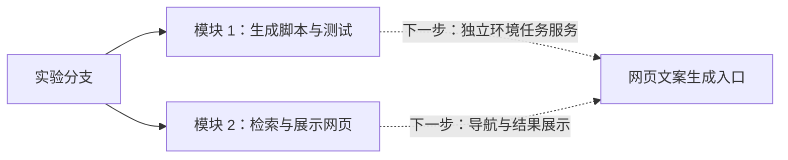

# 模块 1 + 模块 2 · 合并实验

**商品内容生成 × 多模态商品检索**

| 模块 | 已接入内容 | 使用入口 |
|---|---|---|
| 模块 1 | Qwen 文案生成、事实检查、修复、267 项单元测试 | `scripts/test_copywriting_batch.py` |
| 模块 2 | 图搜、文搜、展示网页与原有检索工程 | `scripts/serve_showcase.py` |

本分支合入两个开发分支的代码，以模块 2 为工程基础，保留双方历史为合并提交的两个父提交。模型依赖分别安装；网页新增生成入口尚待下一步开发。



## 无模型检查

```bash
python scripts/test_copywriting_logic.py
```

原始合并基线为183项模块一测试。本次模块一增量更新后，在本地运行267项测试通过。模型生成需要另行准备 Qwen 权重及生成环境。

[合并实验记录、差异处理与下一步](docs/module12-merge-experiment.md)

[模块 1 原始说明](https://github.com/Zicheng-Xie/E-commerce-Multimodal-Intelligent-Content-and-Retrieval-System/blob/shz-dev/README.md) · [模块 2 完整说明](https://github.com/Zicheng-Xie/E-commerce-Multimodal-Intelligent-Content-and-Retrieval-System/blob/module2-dev/README.md)


## 模块一增量更新

本次补入原题编辑与显示器完整型号保留、材质和功能声明校验、两维人工评测以及HTML文案展示。

| 文件 | 用途 |
|---|---|
| [生成脚本](scripts/test_copywriting_batch.py) | 属性解析、生成、校验与有限修复 |
| [人工评测工具](scripts/evaluate_copywriting.py) | 开发试评、冻结样本与两维评分汇总 |
| [文案展示工具](scripts/show_copywriting_results.py) | 终端查看与HTML导出 |
| [操作说明](docs/copywriting_human_evaluation.md) | 输入输出、运行和独立人工验收流程 |

模块一继续使用Python 3.11生成环境，模块二使用其Python 3.12环境。代码检查分别使用各模块配置。267项通过记录对应模块一单元测试，完整合并回归与真实模型联调还需单独确认。

相关度目标为≥80%，通顺度目标为≥85%。先完成20条开发样本人工试评，再在固定的三个品类各10条独立样本上评测，30条相关度至少24条通过、通顺度至少26条通过。最终人工验收汇总仍待完成。
