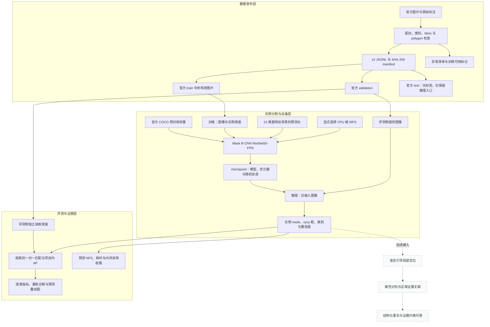
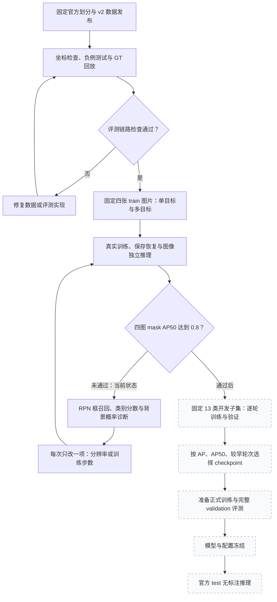

# 模块三：服饰实例分割与细粒度理解

本分支 `module3-dev` 实现服饰数据发布、13 类实例分割、训练恢复、项目内 AP 评测和 CPU / Apple GPU（MPS）运行入口。后续将接入语言引导定位、属性识别与证据约束问答。

**当前进度（2026-11-17）：工程链路已跑通，四图学习门槛尚未通过，正在排查候选框召回与背景误判。** 尚未启动全量训练、完整官方 validation 验收或正式 test 推理。

## 系统架构

下图实线表示已实现的工程路径，虚线表示后续能力。真值只供训练与评测使用；推理输入仅为图像，不使用真值框选择预测。



- 数据内部 bbox 统一为 **xywh**，进入模型时转换为 **xyxy**；mask 在评测时与原图尺寸对齐。
- 默认冻结 backbone，替换为 13 类服饰加背景的 box / mask 预测头；新预测头需要训练，不能直接沿用 COCO 成绩。
- `--device cpu/mps` 显式放置模型与张量。MPS 不可用会报错；设备验证实验不启用静默 CPU fallback。
- 当前 AP 使用项目内类别匹配与 101 点插值，IoU 阈值为 0.50～0.95；未实现 COCO crowd / 面积区间规则，**不等同官方 COCO AP**。

## 开发验证逻辑

这是当前开发流程，包含已完成的检查和未解锁的后续训练。80% 是四张训练图上的诊断门槛，不是正式业务验收指标。



已验证：真实数据 GT 回放的 13 类 AP / AP50 均为 1；CPU 断点续训与连续训练的全部参数一致；CPU / MPS 两组各自 checkpoint 重载后的预测一致。**跨设备结果不承诺逐位一致。**

13 类开发清单已生成：train 211 张、validation 106 张，每类分别至少覆盖 20 / 10 个实例；由于四图门槛尚未通过，未执行该清单上的五轮扩容训练。

## 官方数据划分与质量检查

| 划分 | 图片数 | 当前用途 |
| :--- | ---: | :--- |
| train | 191,961 | 保留官方归属；v2 中 189,381 张可用于训练 |
| validation | 32,153 | 模型选择与评测；尚未进行完整官方验证 |
| test | 62,629 | 无本地标签；尚未进行正式推理 |

train / validation 约为 **85.7% / 14.3%**，不重新切分。训练集发现 2,688 个 polygon 异常和 3 个 bbox 异常，问题计数可重叠，共涉及 2,580 张图；保留原始坐标与官方归属，默认整图排除训练，避免漏标服饰被当成背景。validation 当前质量扫描全部可用。

数据证据：[v2 扫描报告](data/module3_segmentation_official_v2/scan_report.json) · [异常明细](data/module3_segmentation_official_v2/issues.jsonl) · [发布 manifest](data/module3_segmentation_official_v2/manifest.json)。

## 实测进度

下列 AP 均来自**相同四张训练图片上的诊断**，不能作为完整 validation、泛化能力或业务验收成绩。

| 对照 | 输入最短边 / 最长边上限 | 总更新步数 | mask AP50 | 结论 |
| :--- | :--- | ---: | ---: | :--- |
| CPU 原配置 | 128 / 192 | 100 | 0% | 未通过 |
| CPU 仅提高分辨率 | 256 / 384 | 100 | 62.62% | 有改善，仍未通过 |
| CPU 仅延长训练 | 128 / 192 | 500 | 0% | 加步数未解决问题 |
| MPS 设备对照 | 256 / 384 | 100 | 37.62% | 可训练，仍未通过 |

CPU / MPS 同配置对照：CPU 训练约 **21.6 秒**，MPS 约 **150.9 秒**。MPS 每步更新后采样的最大 live / driver 内存约 **350.85 / 1,234.73 MiB**，并非整个进程的峰值内存。每个后端仅单次运行、开始时短暂并行，且包含首次使用开销，不能外推为大规模性能结论。

此前沙箱内 MPS 检测失败不代表本机没有 GPU：沙箱外已跑通真实四图 MPS 训练。当前诊断的直接失败环节包括 RPN 候选遗漏和 ROI 正确类别分数偏低；提高分辨率有效，但尚未证明是唯一根因。

进度证据：[学习门槛实验](artifacts/module3_learning_v1/progress.md) · [候选框与类别诊断](artifacts/module3_diagnosis_v1/progress.md) · [CPU/MPS 对照](artifacts/module3_device_comparison_v1/progress.md)。

## 工程入口

| 路径 | 功能 |
| :--- | :--- |
| `src/multimodal_ecommerce/segmentation.py` | 数据契约、坐标转换、mask 与 bbox 指标 |
| `scripts/publish_module3_official.py` | 流式生成 v2 发布、异常记录与 manifest |
| `scripts/module3_instances.py` | Mask R-CNN 训练、恢复、批量预测和设备选择 |
| `scripts/module3_learning.py` | 四图学习门槛、固定开发清单与条件扩容流程 |
| `scripts/module3_diagnose.py` | RPN / ROI 诊断与分辨率、更新步数对照 |
| `scripts/module3_device_check.py` | 固定四图 CPU / MPS 训练、时间与内存验证 |
| `src/multimodal_ecommerce/instance_metrics.py` | 项目内实例匹配与 AP 评测 |
| `configs/module3_segmentation.json` | 数据版本、模型与开发门槛配置 |

## 本地使用

Python 3.12 环境安装模块三依赖后，运行核心测试与查看入口：

```bash
python -m pip install -r requirements-module3.txt
python -m pytest -c pytest-module3.ini
export PYTHONPATH="$PWD/src:$PWD/scripts"
python scripts/module3_instances.py --help
python scripts/module3_device_check.py --help
```

分支内的 **15 项核心测试**已通过；本地完整工作区另有数据审计等回归测试，共 19 项通过。训练需要先准备本地原始数据、完整 v2 JSONL 和官方预训练权重，详见[阶段记录](docs/module3_segmentation.md)。通用训练入口默认输入为 128 / 192；256 / 384 对照由独立实验入口设置，不要混用其成绩。

## 上传范围与后续工作

代码、配置、测试、数据 manifest / 审计、小型预测文件、实验报告和对照图已同步。原始图片、完整 split JSONL、大型模型权重和 checkpoint 保留在本地，**仅 clone 此分支无法复原全部训练大文件**。历史实验 manifest 可能引用这些本地文件，不能把它们全部视为仓库自带产物。

详见[上传范围与复现边界](docs/module3_git_handoff.md)、[大文件排除与哈希清单](docs/module3_upload_inventory.json)。阶段文档中“尚未同步 GitHub”是对应日期的历史状态，当前 README 反映本次同步进度。

接下来继续固定四图诊断 RPN 召回与 ROI 背景偏置，验证可学习的训练配置；通过门槛后再执行覆盖 13 类的开发实验，随后准备正式训练。语言引导定位、属性抽取和证据问答仍为后续能力，尚未交付。
