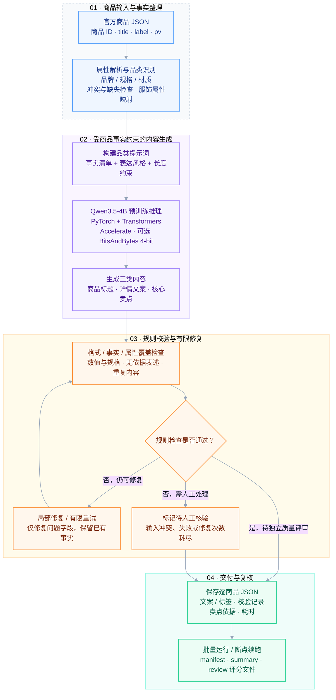
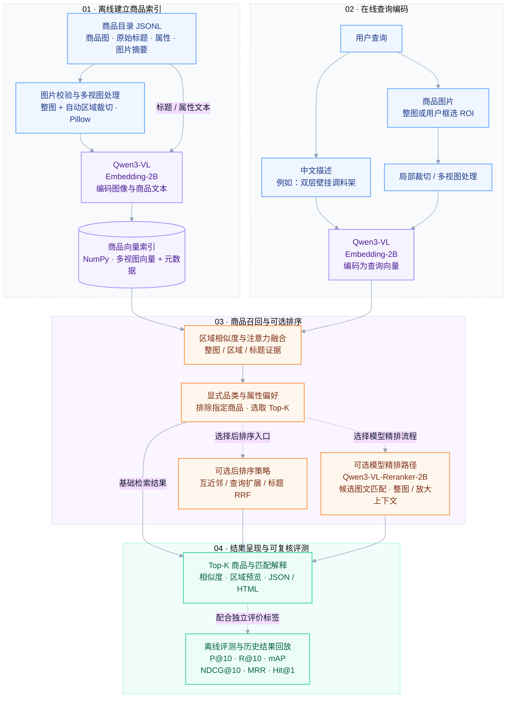

<div align="center">

# Multimodal E-commerce

### 电商多模态智能内容与检索系统

**商品属性 → 智能内容生成 ｜ 文本 / 图片 → 相关商品检索**

[模块 1 · 内容生成](#模块-1商品内容智能生成) · [模块 2 · 多模态检索](#模块-2多模态商品检索) · [指标与结果](#评测指标与实际结果) · [快速开始](#环境与快速开始) · [分支与源码](#分支与源码)

</div>

---

## 项目概览

面向电商商品信息处理的 AI 工程：模块 1 将原始商品属性组织成标题、详情与卖点；模块 2 将中文描述或商品图片转化为检索请求，返回相关商品及匹配依据。

| 模块 | 用户可以完成什么 | 核心技术 | 实现分支 |
| :--- | :--- | :--- | :--- |
| **01 · 商品内容智能生成** | 批量生成中文标题、详情文案与核心卖点，校验事实和属性覆盖，支持局部修复与断点续跑 | Qwen3.5-4B · 规则约束 · 提示词工程 · 4-bit 量化 | `main` |
| **02 · 多模态商品检索** | 中文搜商品、以图搜商品、框选局部检索，查看排序与区域匹配解释 | Qwen3-VL-Embedding-2B · 多视图融合 · 可选 Qwen3-VL-Reranker-2B 精排 | [`module2-dev`](https://github.com/Zicheng-Xie/E-commerce-Multimodal-Intelligent-Content-and-Retrieval-System/tree/module2-dev) |
| **03 · 细粒度服饰语义理解** | 项目规划模块；本页集中展示前两个分支已提供的实现 | 待独立模块完善 | — |

> `main` 是项目说明入口，两个模块的代码分别维护在开发分支，目前独立运行。本页中的命令需切换到对应开发分支后执行。

你可以把整个项目理解为两类工作：**帮助商家把已有商品信息写清楚，帮助用户把想要的商品找出来。** 例如，商家把材质和规格交给模块 1，获得待复核的中文文案；用户把一句描述或商品照片交给模块 2，获得排序后的商品列表。

| 阅读目的 | 建议从哪里开始 |
| :--- | :--- |
| 想了解系统能做什么、怎么做 | 两个模块的彩色流程图与输入输出示例 |
| 想了解模型、技术栈与可调参数 | 模块 1 的生成参数、模块 2 的检索和模型配置表 |
| 想判断当前效果 | 评测目标、两轮盲测与分模态结果，结合样本规模阅读 |
| 想自己运行 | 环境与快速开始，再进入对应分支查看详细说明 |

## 模块 1：商品内容智能生成

**输入商品事实，输出可追溯的中文电商内容。** 面向 3C 数码、服饰穿搭、家居日用，支持自定义表达风格与内容长度。



| 技术层 | 实际使用 | 对应能力 |
| :--- | :--- | :--- |
| 数据与规则 | Python 3.11 · JSON · 商品属性解析与品类规则 | 整理商品事实，映射服饰标签，定位冲突与缺失 |
| 生成模型 | Qwen3.5-4B · PyTorch · Transformers | 根据商品事实生成三类简体中文文案 |
| 推理与资源 | Accelerate · BitsAndBytes（可选 4-bit）· CUDA | 在本地 GPU 执行推理，提供量化选项 |
| 质量与交付 | 格式/事实校验 · 局部修复 · 逐商品记录 · review 文件 | 支持批量生成、续跑、耗时分析及独立质量复核 |

当前为预训练模型推理与规则约束，未进行专门微调。具体输入、参数和验收口径见下文。

**源码入口：** [生成与修复主流程](scripts/test_copywriting_batch.py) · [环境与使用说明](docs/copywriting_human_evaluation.md)

### 1.1 解决什么问题

商家往往已经有品牌、材质、尺寸等信息，但这些信息分散在属性字段里，不能直接作为商品详情发布。模块 1 先把属性整理清楚，再让模型按品类和指定风格组织语言，最后检查是否遗漏关键事实、写错数字或添加没有依据的功效。

例如，一条商品只有“直筒、长裤、聚酯纤维 65% / 棉 35%”等属性时，系统可以把它组织成标题、详情和若干条有依据的卖点。这个例子用于说明输入输出；真实生成内容需要经过规则检查和质量复核。

### 1.2 输入与输出

输入为官方格式 JSON，顶层以商品 ID 为键。`pv` 中的 `#:#` 分隔属性名与属性值，`#;#` 分隔不同属性。

```json
{
  "demo_001": {
    "title": "示例直筒休闲裤",
    "label": "休闲裤",
    "pv": "服装版型#:#直筒#;#裤长#:#长裤#;#材质成分#:#聚酯纤维65% 棉35%",
    "url": "",
    "video": ""
  }
}
```

| 输出内容 | 含义 | 保存位置或字段 |
| :--- | :--- | :--- |
| 商品标题 | 编辑原题中有属性依据的片段，保留商品类型、已核实型号和关键特征 | 每条记录的 `result.title` |
| 详情文案 | 连贯介绍已知属性与设计信息 | `result.description` |
| 核心卖点 | 按要求提炼主要特征 | `result.selling_points` |
| 服饰标签 | 将已有服饰属性映射成结构化标签 | `fashion_tags`；来源是属性文本 |
| 检查与修复记录 | 保存格式、事实、覆盖检查与每次生成尝试 | `validation`、`attempts` |
| 运行与质量汇总 | 保存本次配置、加载信息、待填写评分和验收状态 | `manifest.json`、`loading.json`、`review.json`、`summary.json` |

结果写入 `outputs/copywriting_v3/<运行时间>/`，其中 `records/` 为逐商品 JSON。图片 URL 与视频字段随输入保留，当前生成过程使用商品文本属性。

标题优先沿用原题中有属性依据的表达。例如，原题同时出现 `AW3418DW` 和 `AW3418HW`，而属性表与规格选项支持 `AW3418DW` 时，标题保留已核实的 `AW3418DW`，例如「Dell/戴尔 AW3418DW 显示器 3440×1440」。型号仍有实质冲突时转人工核验。详情和卖点也会检查无依据的材质、功能与规格声明。

### 1.3 常用生成参数

下面是 `scripts/test_copywriting_batch.py` 的命令行默认值；“默认值”与分支 README 中的示例配置分开说明。

| 参数 | 默认值 / 可选值 | 通俗解释 |
| :--- | :--- | :--- |
| `--length` | `medium`；可选 `short / medium / long` | 选择整套文案长度上限，见下表 |
| `--points` | `3` | 每件商品要求生成的卖点数量 |
| `--max-tokens` | `512` | 每次生成的最大新 token 数；token 是模型处理文字的单位，不等于汉字数 |
| `--repair-attempts` | `1` | 首次生成之后最多再修复 1 次；不会无限重试 |
| `--quantization` | `none`；可选 `4bit` | 是否使用 4-bit 量化以减少模型权重的显存占用 |
| `--style` | 空字符串，可自定义 | 例如“专业简洁”；控制措辞风格，不会增加商品本身的功能 |
| `--limit` | `0` | 本次处理数量；`0` 表示不额外限制 |
| `--gpu-memory / --cpu-memory` | `5GiB / 10GiB` | 模型加载时的设备内存预算，不是实测峰值或整机最低配置 |
| `--compact-prompt` | 默认关闭 | 省略品类示例，保留事实与表达规则，缩短提示词 |
| `--use-cache` | 默认关闭 | 启用生成缓存；会改变推理的速度与显存使用 |
| `--dry-run` | 默认关闭 | 只解析输入和保存检查材料，不加载模型 |
| `--resume-dir` | 需显式指定 | 从已有运行目录继续；`--retry-failed` 可重做失败商品并保留旧记录 |
| `--profile-timing` | 默认关闭 | 记录首 token 等待时间及后续生成速度 |

| 长度档位 | 标题上限 | 详情上限 | 每条卖点上限 |
| :--- | ---: | ---: | ---: |
| `short` | 24 | 80 | 24 |
| `medium` | 40 | 150 | 40 |
| `long` | 40 | 300 | 60 |

上表为字符长度约束，可分别通过 `--title-max`、`--description-max`、`--point-max` 覆盖。分支使用示例采用 `4bit + compact-prompt + use-cache + max-tokens 384`，其中 `384` 是示例值，命令行默认仍为 `512`。

### 1.4 内容质量怎样衡量

| 指标 | 目标或统计口径 | 怎么理解 |
| :--- | :--- | :--- |
| 文案相关度 | **验收目标 ≥80%**；两维人工评测 | 核对核心属性命中与关键遗漏，存在无依据事实的文案记不通过 |
| 文案通顺度 | **验收目标 ≥85%**；两维人工评测 | 根据独立评分，检查语言是否自然、连贯、易读 |
| 格式通过率 | `format_pass_rate`；无单独公开验收阈值 | 是否按规定输出可解析的标题、详情和卖点结构 |
| 事实 / 文案规则通过率 | `fact_rule_pass_rate`、`copywriting_rule_pass_rate` | 自动规则有没有发现数值错误、无依据表述、重复等问题 |
| 综合规则通过率 | `quality_gate_pass_rate` | 自动检查这一关是否通过，之后仍需质量评分 |
| 核心属性覆盖率 | `core_coverage_mean` | 文案有没有表达应覆盖的商品事实；按有覆盖统计的记录求平均 |
| 交付通过率 | `delivery_pass_rate` | 事实、相关、完整、风格和通顺全部通过，且格式合格、无生成错误的商品比例 |
| 生成耗时 | `generation_seconds` | 单件商品全部生成与修复尝试的累计耗时，不含模型加载 |
| 首 token / 生成速度 | `ttft_seconds`、`decode_tokens_per_second` | 开始生成后多久出现第一个 token，以及之后每秒生成多少 token；需启用计时 |

规则通过率按本次计划商品总数计算，缺失记录不会从分母中删掉。`review.json` 使用 `1 / 0 / null` 表示通过、未通过和未评分；评分或运行未完成时，正式指标保持 `null`（待评测）。当前分支尚未公开完成正式验收的相关度、通顺度和统一性能成绩，因此本页展示目标与计算方法，不填写推测值。

参数和统计口径见[生成脚本](scripts/test_copywriting_batch.py)，运行说明见[模块 1 README](docs/copywriting_human_evaluation.md)。

## 模块 2：多模态商品检索

**用中文或图片寻找相关商品，并查看匹配依据。** 支持整图、多区域及 ROI 局部检索；基础区域检索、后排序和模型精排是可选路径，按入口与配置使用。



实线表示主要数据流，虚线表示可选路径或配套评测。图中的排序分支是能力概览，具体组合与输入要求以各入口代码为准。

| 技术层 | 实际使用 | 对应能力与状态 |
| :--- | :--- | :--- |
| 基础工程 | Python 3.12 · NumPy · Pillow · JSONL | 商品目录校验、图像预处理、向量索引与结果导出 |
| 多模态表征 | Qwen3-VL-Embedding-2B · PyTorch · Transformers · qwen-vl-utils | 完整模型编码文本和图片，多视图与 ROI 检索 |
| 排序与解释 | 区域注意力融合 · 互近邻 · 查询扩展 · RRF | 提供可切换的检索/后排序策略与区域证据 |
| 模型精排 | Qwen3-VL-Reranker-2B | 独立候选精排路径，支持完整图文输入及严格分数缓存 |
| 主体与视觉研究 | GroundingDINO · SAM 2.1 · FG-CLIP 2 · Qwen3.5 / Ollama | 主体定位、分割与语义核验适配；新掩码未通过质量检查，保持停用 |
| 业务学习研究 | Multi-Similarity 共享投影 · DINOv2 双图联合注意力与匹配头 | 业务相关性学习、主售/道具识别与角色扩池对照；未替换默认方法 |
| 运行与验证 | Apple MPS / CUDA · 本地 HTTP 开发服务 · pytest · 指标回放 | 支持本地推理与历史结果复核；HTTP 及历史实验还需完整特征库与冻结协议 |

基础检索、模型精排和研究流程分别提供源码入口；模型、数据与完整运行条件见“环境与快速开始”，质量结果见“评测指标与实际结果”。

**源码入口：** [索引构建与区域检索](https://github.com/Zicheng-Xie/E-commerce-Multimodal-Intelligent-Content-and-Retrieval-System/blob/module2-dev/scripts/retrieve_regions.py) · [可选后排序](https://github.com/Zicheng-Xie/E-commerce-Multimodal-Intelligent-Content-and-Retrieval-System/blob/module2-dev/scripts/retrieve_postrank.py) · [完整模型精排](https://github.com/Zicheng-Xie/E-commerce-Multimodal-Intelligent-Content-and-Retrieval-System/blob/module2-dev/src/multimodal_ecommerce/pair_reranker.py) · [复现与运行说明](https://github.com/Zicheng-Xie/E-commerce-Multimodal-Intelligent-Content-and-Retrieval-System/blob/module2-dev/README.md)

### 2.1 解决什么问题

用户不一定知道商品的准确名称：可能只会描述“放在厨房墙上的双层架子”，也可能只有一张包含人物、道具和背景的图片。模块 2 将描述或图片转成可以比较的数字向量，在商品库里寻找相关结果；用户也可以框选图片里的目标区域，减少背景干扰。

| 使用方式 | 用户提供什么 | 系统做什么 |
| :--- | :--- | :--- |
| 中文搜商品 | 一句话描述 | 编码文本，与商品图片和商品文本表征比较 |
| 以图搜商品 | 一张商品图 | 使用整图或多区域特征检索相关商品 |
| 局部检索 | 图片和 ROI 框 | 裁出关注区域，再编码查询，聚焦该区域中的商品 |
| 带偏好查询 | 显式品类或属性 | 在融合策略中对匹配/冲突进行加减分；并非硬性过滤 |
| 结果解释 | 一次检索请求 | 返回排名、分数、区域权重、关注区域和属性匹配依据 |

“相关商品”按当前业务评测协议判断；向量相似度与精排分数用于排序，不能直接当成正确概率。模型精排的目标也会受配置指令影响，例如当前精排配置强调服饰同款匹配；跨品类使用需按业务定义复核。

### 2.2 主要输入与输出

商品目录使用 JSONL，即每行一个商品对象。`image_path` 相对目录文件所在位置，`image_sha256` 填写实际图片摘要，用于检查图片是否改变。

```json
{"id":"item_001","text":"原始商品标题","category":"家居日用","attributes":{},"evaluation_eligible":true,"image_path":"images/item_001.jpg","image_sha256":"填写该图片真实的SHA256"}
```

基础区域检索输出 `results.json` 与 `results.html`：JSON 用于程序处理，HTML 用于查看商品和匹配区域。结果包括 `rank`、`score`、整图/区域/文本分数、属性证据和 `focus_view`；运行记录另存模型配置、索引加载耗时与查询耗时。

### 2.3 检索参数：哪些可以调，分别影响什么

**命令行参数**（基础入口 `scripts/retrieve_regions.py`）：

| 参数 | 默认值 / 格式 | 通俗解释 |
| :--- | :--- | :--- |
| `--text / --image` | 查询时二选一 | 输入中文描述或图片；当前入口不同时接收两种输入 |
| `--top-k` | `10` | 返回前多少件商品；业务评测固定看前 10 件 |
| `--strategy` | `attention_fused` | 默认结合区域、整图和可用商品文本证据；另有 `global / mean / attention` 对照 |
| `--query-views` | `multi`；可选 `global` | 图片查询使用多视图还是仅整图；显式 ROI 会走裁切后的多视图处理 |
| `--roi` | `x1 y1 x2 y2`，归一化坐标 | 取值在 0–1，且左上坐标小于右下坐标；例如 `0.1 0.1 0.9 0.9` 表示保留图片中间 80% 宽高区域 |
| `--category` | 可选品类文本 | 提供明确的品类偏好，默认融合策略据此加减分 |
| `--attributes` | 属性 JSON 文件路径 | 属性名到期望值的映射；用于显式属性匹配和冲突判断 |
| `--exclude-id` | 可重复指定 | 将指定商品排除出结果 |
| `--index / --output` | 索引目录 / 新结果目录 | 查询必须对应已建索引；索引构建和结果导出均要求新目录，避免覆盖 |

**模型与区域配置**（项目固定配置值）：

| 配置项 | 当前值 | 含义 |
| :--- | :--- | :--- |
| 嵌入模型 / 向量维度 | Qwen3-VL-Embedding-2B / **2048 维** | 把图片和文字转成同一空间中的 2048 个数字，供相似度比较 |
| 嵌入推理 | `bfloat16`、`batch_size=1`、`max_length=2048`、`max_pixels=262144` | 模型数值精度、批量大小、序列与图像处理上限；`max_length` 不是向量维度 |
| 精排模型 | Qwen3-VL-Reranker-2B | 对候选配对进一步打分；独立于基础向量检索 |
| 精排推理 | `bfloat16`、`batch_size=1`、`max_length=10240` | 精排模型输入配置；图像像素范围 `4096–1843200` |
| `max_views / zoom_max_edge` | `7 / 768` | 每张图片最多保留 7 个视图，区域处理最长边为 768 像素；实际视图数由图片决定 |
| `center_fraction / tile_fraction` | `0.8 / 0.65` | 中心裁切与分块视图的比例参数 |
| `roi_padding` | `0.08` | 对目标区域增加上下文边缘的比例参数 |
| `attention_temperature` | `0.07` | 控制区域权重的集中程度，越小越偏向高相似区域 |
| `global_weight` | `0.6` | 整图与区域融合的权重；部分多查询视图融合也使用该参数 |
| `text_weight` | `0.2` | `attention_fused` 中商品文本分数权重；相应视觉分数权重为 `0.8` |
| `category_bonus / attribute_bonus` | `0.03 / 0.05` | 显式品类和属性匹配的分数调整系数，属于排序规则参数 |

这些数值是当前工程配置，不代表已通过验收的最优参数；独立实验有自己的冻结配置。来源：[嵌入模型配置](https://github.com/Zicheng-Xie/E-commerce-Multimodal-Intelligent-Content-and-Retrieval-System/blob/module2-dev/configs/embedding_model.json)、[精排模型配置](https://github.com/Zicheng-Xie/E-commerce-Multimodal-Intelligent-Content-and-Retrieval-System/blob/module2-dev/configs/reranker_model.json)、[区域配置](https://github.com/Zicheng-Xie/E-commerce-Multimodal-Intelligent-Content-and-Retrieval-System/blob/module2-dev/configs/retrieval_regions_v1.json)。

### 2.4 可选研究能力与量化工作量

| 研究方向 | 关键结构或规模 | 当前结论 |
| :--- | :--- | :--- |
| 主体定位与分割 | GroundingDINO 检测、SAM 2.1 分割；435 张原图审计，412 次完整检测、383 次 SAM 调用 | 发现商品结构缺失、道具残留等问题，新掩码保持停用，保留整图回退 |
| 细粒度辅助 | FG-CLIP 2，全局/局部/文本特征，最高 5% 有效 patch 聚合 | 作为辅助证据，不自动进入默认方法 |
| 商品业务度量学习 | 冻结骨干，`2048→256→256` 共享投影，Multi-Similarity 困难样本学习 | 学习业务相关性；未知关系不直接当负例 |
| 双图匹配 | 12 层 DINOv2-small，`448×224` 联合输入、512 个 patch、384 维联合特征；只训练匹配头 | 已完成 7 方法、280 份排序；7,560 次真实配对、1,890 次批前向、18 个家族折头模型重放 |
| 主售修复与角色扩池 | 主售修复 22 方法 / 880 份排序；角色对照 8 方法 / 320 份排序 | 角色扩池在 fresh 开发组的 P/R/mAP/NDCG 退步，未采用 |

“主售”是图片真正要出售的商品，“道具”是搭配展示的其他物件。“家族隔离”是把同一商品家族放在同一分组，减少近似样本同时进入训练和验证造成的偏高结果。研究结果需要单独评价，不会因为代码存在就自动升级为默认策略。

## 评测指标与实际结果

本节汇总截至 **2026-11-04** 已公开的代码配置和 **2026-10-19—11-04 双周报**记录。目标值回答“希望做到什么”，实验结果回答“这一版、这一组样本实际表现如何”，工程检查回答“代码和历史结果是否能按既定口径复核”。

### 3.1 一眼看懂项目目标

| 模块 | 指标 | 目标 | 当前状态 |
| :--- | :--- | :--- | :--- |
| 内容生成 | 文案相关度 | **≥80%** | 正式验收待完成，未公开最终通过率 |
| 内容生成 | 文案通顺度 | **≥85%** | 正式验收待完成，未公开最终通过率 |
| 商品检索 | P@10 | **≥60%，硬目标** | 首次盲测总体下界超过 60%，图片分组未过；第二次总体未过 |
| 商品检索 | R@10 | **尽量 ≥85%，偏好目标** | 两次盲测所列候选总体下界超过 85%；图片分组仍需分别看 |
| 商品检索 | mAP / NDCG@10 / MRR / Hit@1 | 与完整基线比较，同时观察变化 | 当前配置未为这四项指定统一绝对通过线 |

模块 2 当前目标来自[目标配置](https://github.com/Zicheng-Xie/E-commerce-Multimodal-Intelligent-Content-and-Retrieval-System/blob/module2-dev/configs/module2_current_target.json)。历史 70% 召回协议保留用于旧结果回放，当前偏好目标为 85%。评估还需与 `global`（整图基线）、`region_title`（区域与标题基线）比较，分别报告总体、文本和图片结果。

### 3.2 检索六指标，用日常语言怎么理解

| 指标 | 通俗解释 | 计算或读法 |
| :--- | :--- | :--- |
| **P@10，前十准确率** | 前 10 个推荐里，有多少是相关商品？ | 前 10 名相关数 ÷ **固定 10**；6 件相关就是 60% |
| **R@10，前十召回率** | 商品库里所有相关商品，有多少进入前 10？ | 前 10 名相关数 ÷ **完整图库相关商品数**；不能只拿候选池当分母 |
| **mAP，平均精度均值** | 相关商品整体有没有排在前面？ | 在完整排序中计算各查询的 AP，再求平均；仓库字段名为 `ap` |
| **NDCG@10，前十排序质量** | 前 10 个结果的顺序好不好？ | 靠前的相关商品权重更高，并相对理想排序归一化 |
| **MRR，首个相关结果排名** | 用户通常要看几项才遇到第一个相关商品？ | 首个相关商品排名的倒数，再对查询求平均；首个在第 2 名时为 0.5 |
| **Hit@1，首位命中率** | 第一件推荐是不是相关商品？ | 第一名相关的查询数 ÷ 查询总数 |

这些指标在下表统一乘以 100，以百分比展示；它们关注的角度不同。例如，图库中有 8 件相关商品，前 10 名命中 6 件，则 P@10=60%、R@10=75%。若图库有 20 件相关商品，前 10 名最多只能召回其中 10 件，单条查询的 R@10 上限就是 50%。因此应结合图库规模、相关商品数量和查询构成理解结果。

### 3.3 两轮独立 AI 盲测：总体、文本、图片分别看

两轮测试均先冻结 AI 评价标签，再运行候选方法。以下范围是**未知 AI 标签补全下的计算上下界**：某些关系暂时无法确定是否相关，代码在保留这些未知项的情况下计算可能范围。例如 `63.83–71.00` 表示可能的计算范围，而非均值加减误差。各指标分别求界，不能把一行的所有上界当作同一次标签补全的联合成绩。

**第一次：300 件商品、60 条查询。** 候选方法为 `business_cross20_text_described20_image`。

| 分组 / 方法 | P@10 | R@10 | mAP | NDCG@10 | MRR | Hit@1 |
| :--- | ---: | ---: | ---: | ---: | ---: | ---: |
| 总体 · 候选 | 63.83–71.00 | 89.06–94.71 | 77.86–87.11 | 80.70–89.40 | 85.00–89.96 | 81.67–86.67 |
| 总体 · 整图基线 `global` | 54.17–59.67 | 72.30–82.42 | 66.50–76.50 | 68.59–78.65 | 79.51–86.09 | 71.67–80.00 |
| 总体 · 区域标题基线 `region_title` | 57.50–63.67 | 76.52–85.71 | 70.77–80.51 | 72.41–81.94 | 82.17–88.12 | 76.67–83.33 |
| 文本 · 候选 | 84.33–90.00 | 94.33–97.25 | 95.32–98.44 | 95.90–98.10 | 100.00 | 100.00 |
| 图片 · 候选 | 43.33–52.00 | 82.73–91.99 | 60.41–75.78 | 65.50–80.70 | 70.00–79.92 | 63.33–73.33 |

这一轮总体 P/R 的下界达到当前目标，但图片 P@10 即使取上界也不足 60%。总体平均值不能代替图片检索分组的结论。

**第二次：96 件商品、24 条查询。** 所列候选方法为 `grounded_whole_zoom_union`，表示整图与放大上下文联合的候选流程。

| 分组 / 方法 | P@10 | R@10 | mAP | NDCG@10 | MRR | Hit@1 |
| :--- | ---: | ---: | ---: | ---: | ---: | ---: |
| 总体 · 候选 | 49.58–54.17 | 89.80–94.86 | 73.14–77.11 | 75.05–77.07 | 75.60–78.03 | 70.83–75.00 |
| 总体 · 整图基线 `global` | 49.17–54.17 | 88.08–94.91 | 67.63–71.05 | 71.45–75.53 | 70.14–73.06 | 58.33–62.50 |
| 总体 · 区域标题基线 `region_title` | 49.58–54.58 | 88.94–95.77 | 70.73–74.03 | 73.76–77.44 | 75.00–76.04 | 66.67 |
| 文本 · 候选 | 59.17–65.83 | 91.32–91.44 | 84.71–90.16 | 86.73–89.98 | 88.69–92.86 | 83.33–91.67 |
| 图片 · 候选 | 40.00–42.50 | 87.78–100.00 | 61.57–64.05 | 63.36–64.17 | 62.50–63.19 | 58.33 |

这一轮总体 R@10 下界达到 85% 偏好目标，但总体 P@10 上界仍低于 60%。图片 P@10 仍是主要短板；文本区间跨越 60%，也不能据此判为确定通过。

两个测试的商品库、查询和候选版本不同，不能将两张表当成同一测试集上的连续版本增益。区间来自 AI 标签计算，不是置信区间或人工验收准确率；当前人工标签数为 **0**，正式验收指标为 **null**。两轮测试集均已使用（`consumed`），后续不能再次称为新的独立盲测。完整分模态基线与代码映射见[六指标明细](https://github.com/Zicheng-Xie/E-commerce-Multimodal-Intelligent-Content-and-Retrieval-System/blob/module2-dev/docs/weekly_metrics.md)。

<details>
<summary><strong>展开：双图融合与角色扩池开发实验（六指标）</strong></summary>

A/tune 为调参开发组，B/regression 为回归开发组，C/fresh 为已曝光的新开发组；三组均不是新的独立盲测。A/B 各 16 查询（8 文本 + 8 图片），C 为 8 图片查询；图库各 315 件，C 与 A 共用图库。开发关系合计 12,600 条，不按方法数重复累加。

| 方法 / 开发组 | P@10 | R@10 | mAP | NDCG@10 | MRR | Hit@1 |
| :--- | ---: | ---: | ---: | ---: | ---: | ---: |
| 双图融合 · A/tune | 82.50–91.88 | 39.88–56.89 | 75.90–87.46 | 85.65–95.57 | 100.00 | 100.00 |
| 双图融合 · B/regression | 71.88–86.88 | 37.94–61.36 | 70.73–89.72 | 75.92–93.32 | 87.50–96.88 | 81.25–93.75 |
| 双图融合 · C/fresh | 55.00–78.75 | 39.55–56.25 | 47.31–67.84 | 57.44–82.14 | 79.17–100.00 | 62.50–100.00 |
| 角色扩池 · A/tune | 81.88–90.62 | 38.98–55.61 | 74.43–85.83 | 84.98–93.19 | 96.88 | 93.75 |
| 角色扩池 · B/regression | 70.62–84.38 | 36.93–60.50 | 68.87–90.32 | 74.33–94.09 | 86.46–100.00 | 81.25–100.00 |
| 角色扩池 · C/fresh | 43.75–67.50 | 30.04–47.21 | 42.37–60.75 | 50.20–71.12 | 84.38–87.50 | 75.00 |

双图融合对应 `business_joint_attention_fusion`，角色扩池对应 `expanded_pool_role_sort`。角色扩池在 fresh 的 P/R/mAP/NDCG 相对原始候选与排序对照严格退步，因此不采用。区间有重叠时，应查看同一批未知标签下的配对比较，不能仅用区间端点相减认定提升。OOF（各折验证预测拼接）用于开发诊断，默认方法未升级。

</details>

### 3.4 工程验证、证据规模与推理耗时

| 项目 | 已记录数值 | 统计口径 |
| :--- | :--- | :--- |
| 精选 Python 文件 | 102 个 | 模块 2 首次代码发布的功能、依赖与测试文件 |
| 单元 / 集成测试 | 101 项 / 13 项通过 | 首次发布验证记录，非本次文档修改重新运行的测试 |
| 完整排序回放 | 11 组、1,756 份一致 | 两轮盲测 180+96，双图 280，角色 320，主售修复 880 |
| 两轮盲测标签关系 | 18,000 / 2,304 条 | 未知项分别 59 / 16 条，保留 `null` |
| 授权回放证据 | 32,904 条去重 AI 关系，约 252 KB 压缩数据 | 不包含原始大型图库或模型；相同关系和排序不重复累计 |
| 2026-11-01 文本 / 图片编码 | 2.422 / 4.288 秒 | Apple M4 Pro 48 GiB、MPS 历史单次编码记录 |
| 2026-11-01 单对精排 | 1.544 秒 | 完整 Qwen 精排的一次配对评分，不含模型加载 |
| 2026-11-04 文本 / 图片编码 | 2.799 / 4.550 秒 | 第二次 Mac MPS 单次运行检查 |
| 2026-11-04 单对精排 | 1.592 秒 | 第二次单对评分记录，不含模型加载 |

以上秒数是单次模型调用记录，不是端到端 Top-10 查询时延、平均吞吐量或 P50/P95（50%/95% 请求可在该时间内完成）。完整查询还可能包含索引加载、多视图编码、候选精排和结果导出。两次单次计时也不足以证明性能变快或变慢。

模块 2 的 `query_and_search_seconds_excluding_model_and_index_load` 记录查询编码和检索耗时，排除模型/索引加载；`index_load_seconds_including_hash_verification` 单独记录索引加载与摘要校验。模块 1 将模型加载写入 `loading.json`，生成和重试耗时写入逐商品记录。

数据来源：[运行收据](https://github.com/Zicheng-Xie/E-commerce-Multimodal-Intelligent-Content-and-Retrieval-System/blob/module2-dev/evidence/runtime_receipts.json)、[证据来源与计数](https://github.com/Zicheng-Xie/E-commerce-Multimodal-Intelligent-Content-and-Retrieval-System/blob/module2-dev/evidence/provenance.json)、[首次发布验证记录](https://github.com/Zicheng-Xie/E-commerce-Multimodal-Intelligent-Content-and-Retrieval-System/blob/module2-dev/release/verification.json)。历史回放重算已有排序的指标，不重新运行视觉模型；工程检查通过和业务质量通过分别报告。

## 环境与快速开始

### 4.1 两个模块分别准备环境

| 项目 | 模块 1：内容生成 | 模块 2：商品检索 |
| :--- | :--- | :--- |
| 分支 | `main` | `module2-dev` |
| Python | 已验证 3.11 | 使用 3.12；工程声明 `>=3.12,<3.15` |
| PyTorch | `2.9.1+cu128` | `2.8.0`，torchvision `0.23.0` |
| Transformers / Accelerate | `5.3.0 / 1.15.0` | `4.57.1 / 1.12.0` |
| 其他主要依赖 | BitsAndBytes `0.50.2` | qwen-vl-utils `0.0.14`、NumPy `2.5.3`、Pillow `12.3.0` |
| 设备记录 | 已验证 RTX 4060 Laptop，8 GB 显存 | 支持 Apple MPS / CUDA；Mac 历史记录见上表 |
| 权重位置 | `models/Qwen3.5-4B/` | `.models/<模型仓库名称>/` |
| 外部组件 | 本地模型文件 | 真实检索入口需设置 Ollama；历史回放无需 Ollama 或 GPU |

两套依赖版本不同，请分别建立虚拟环境。设备记录是已验证环境，不是最低配置承诺。模型权重、原图、向量缓存和完整本地特征库不随仓库分发；运行真实模型时按对应分支说明准备。

### 4.2 模块 1：先检查输入，再生成一条

在仓库根目录运行以下命令。先准备本地 Qwen3.5-4B 权重和官方格式的商品 JSON，再用实际文件路径替换示例路径。生成环境的版本与安装步骤见[模块一使用说明](docs/copywriting_human_evaluation.md)。

```bash
# 检查输入
python scripts/test_copywriting_batch.py run --samples path/to/products.json --dry-run

# 生成一条文案
python scripts/test_copywriting_batch.py run --samples path/to/products.json --model-dir models/Qwen3.5-4B --run-dir outputs/copywriting_demo --quantization 4bit --compact-prompt --use-cache --max-tokens 384 --limit 1

# 导出浏览器可打开的文案展示页
python scripts/show_copywriting_results.py outputs/copywriting_demo --html outputs/copywriting_demo/results.html
```

批量生成时可提高 `--limit` 或省略此参数。每条 JSON 记录的 `result` 包含标题、详情和核心卖点，`validation` 保存自动诊断结果。

人工评测先用 **20 条开发样本**校准评分流程，再用**冻结的 30 条独立样本**做正式评测。3C 数码、服饰穿搭、家居日用各 10 条，按原始属性逐条打分。相关度要求至少 **24/30**，通顺度要求至少 **26/30**。当前状态为待正式验收。生成评测表、冻结样本和汇总评分的命令见[两维人工评测流程](docs/copywriting_human_evaluation.md)。

### 4.3 模块 2：无需模型，先复核历史结果

切换到 `module2-dev`，在分支根目录执行：

```bash
python3.12 -m venv .venv
source .venv/bin/activate
python -m pip install -e '.[dev,retrieval]'

# 小型夹具验证代码；精简证据重算历史六指标
python -m pytest -q
python scripts/replay_weekly.py
python -m pytest -q integration_tests
```

这组命令只验证代码和历史回放证据。若要执行包含全部静态检查的 `python scripts/check_quality.py`，还需 Node.js；远端 CI 使用 Node 22。

### 4.4 模块 2：准备自己的图片，运行真实检索

在模块 2 环境中安装检索依赖、设置好 Ollama，并准备固定版本模型与商品目录：

```bash
python -m pip install -e '.[retrieval]'
python scripts/download_models_mac.py
export MULTIMODAL_DEVICE=mps
# CUDA 环境将上一行改为 export MULTIMODAL_DEVICE=cuda

# 先按 2.2 节格式准备 data/catalog/products.jsonl 和图片
python scripts/retrieve_regions.py build --dataset data/catalog/products.jsonl --index data/index_regions
python scripts/retrieve_regions.py search --index data/index_regions --text '双层壁挂调料架' --top-k 10 --output artifacts/query_text
python scripts/retrieve_regions.py search --index data/index_regions --image data/catalog/images/item_001.jpg --roi 0.1 0.1 0.9 0.9 --output artifacts/query_roi
```

真实运行不会静默退回 CPU。上述是基础区域检索入口；可选后排序查看 `scripts/retrieve_postrank.py --help`。常驻 HTTP 页面、历史业务学习和角色实验还需要原有完整特征库、冻结协议与相关数据，不能只靠公开回放包启动。详见[模块 2 运行说明](https://github.com/Zicheng-Xie/E-commerce-Multimodal-Intelligent-Content-and-Retrieval-System/blob/module2-dev/README.md)与[复现文档](https://github.com/Zicheng-Xie/E-commerce-Multimodal-Intelligent-Content-and-Retrieval-System/blob/module2-dev/docs/reproduction.md)。

## 当前进展与后续重点

| 方向 | 已具备的能力 | 接下来需要解决的问题 |
| :--- | :--- | :--- |
| 内容生成 | 三类中文内容、品类适配、属性规则、局部修复、批量与续跑 | 完成独立样本质量评分，报告相关度/通顺度与分品类结果 |
| 多模态检索 | 文本/图片/ROI、区域解释、独立模型精排、历史评测回放 | 提高图片查询 P@10，在新的独立数据上检验当前业务目标 |
| 主体与业务学习 | 检测/分割适配、双图匹配、主售/道具对照 | 改进结构保留和语义核验；对有退步的方法继续保留原策略 |
| 性能与交付 | Mac MPS/CUDA 路径、单次真实推理记录、单元/集成验证 | 用明确的硬件、样本和冷热启动条件补充端到端时延与吞吐统计 |

## 分支与源码

| 分支 | 职责 | 阅读入口 |
| :--- | :--- | :--- |
| `main` | 项目总览、模块功能流程与技术栈 | 当前 README |
| `main` | 模块 1：商品内容智能生成 | [README 与运行方法](docs/copywriting_human_evaluation.md) |
| `module2-dev` | 模块 2：多模态商品检索 | [README 与运行方法](https://github.com/Zicheng-Xie/E-commerce-Multimodal-Intelligent-Content-and-Retrieval-System/blob/module2-dev/README.md) |

两个模块的依赖版本不同，建议分别创建虚拟环境。模型、数据准备和具体命令请进入对应分支查看。

### 常用代码与证据导航

| 入口 | 主要内容 |
| :--- | :--- |
| [模块 1 生成脚本](scripts/test_copywriting_batch.py) | 属性解析、生成、修复、计时与质量汇总 |
| [模块 2 scripts/](https://github.com/Zicheng-Xie/E-commerce-Multimodal-Intelligent-Content-and-Retrieval-System/tree/module2-dev/scripts) | 索引构建、查询、服务、研究实验和回放入口 |
| [模块 2 src/](https://github.com/Zicheng-Xie/E-commerce-Multimodal-Intelligent-Content-and-Retrieval-System/tree/module2-dev/src/multimodal_ecommerce) | 图文编码、区域检索、精排与指标计算实现 |
| [模块 2 configs/](https://github.com/Zicheng-Xie/E-commerce-Multimodal-Intelligent-Content-and-Retrieval-System/tree/module2-dev/configs) | 固定模型版本、区域参数和当前目标 |
| [模块 2 docs/](https://github.com/Zicheng-Xie/E-commerce-Multimodal-Intelligent-Content-and-Retrieval-System/tree/module2-dev/docs) | 完整六指标表、证据来源与复现说明 |
| [模块 2 evidence/](https://github.com/Zicheng-Xie/E-commerce-Multimodal-Intelligent-Content-and-Retrieval-System/tree/module2-dev/evidence) | 已授权的精简回放证据、来源摘要与运行收据 |
| [模块 2 release/](https://github.com/Zicheng-Xie/E-commerce-Multimodal-Intelligent-Content-and-Retrieval-System/tree/module2-dev/release) | 首次代码发布时的源码清单与检查记录 |

## License

[MIT](LICENSE)
