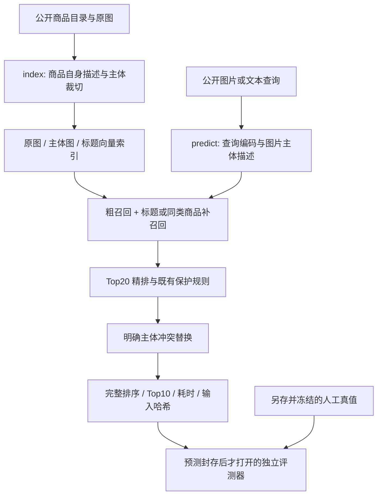

# 模块二：通用推理引擎与独立验收准备

2026-11-10 后续自动开发对照已完成：成对学习未通过不退化检查，主体描述清理与类型约束保留为实验候选，原冻结默认未替换。本轮没有新增人工任务，未使用最终保留集。见 [自动开发报告](module2_automatic_development_20261110.md)。下文冷启动与 431 项测试均指原工程冻结时的证据；本轮完整检查为 453 个 Python 文件、444 项测试。

2026-11-10。本阶段将 `primary_public_conflict_matched_v1` 工程化为独立 CLI，未替换现有服务默认实现，未继续根据开发答案选策略，未启动真实验收。

## 已交付与验证范围

| 交付 | 本轮结果 | 证据 |
|---|---|---|
| 通用推理 | `index`、`predict`，支持新商品目录及图／文查询 | [CLI](../scripts/module2_selected_runtime.py) |
| 既有开发缓存重放 | 845 件商品、55 条完整排序与选中候选全部一致 | [重放报告](../artifacts/module2_selected_runtime_20261110/replay/report.json) |
| 最终代码真实空缓存测试 | 24 件开发商品，新建索引；图搜 2 条、文搜 2 条均完成完整排序 | [冷启动报告](../artifacts/module2_selected_runtime_20261110/cold_serialized/report.json) |
| 实际模型工作 | 新生成 24 份商品描述、24 次裁切决策、9 张主体裁切、40 对真实精排分数 | [索引清单](../artifacts/module2_selected_runtime_20261110/cold_serialized/index/manifest.json) |
| 工程冻结 | 实际权重、Ollama digest、源码、依赖版本、配置、提示词、预处理、索引及验证证据共同绑定 | [冻结清单](../artifacts/module2_selected_runtime_20261110/release.json) |
| 独立标注工具 | 独立文本查询模板、盲化全关系标注包、CSV 严格校验与私有真值冻结 | [标注 CLI](../scripts/module2_acceptance_gold.py) |
| 独立验收准备 | 元数据预检、一次性执行凭证、相同版本断点续跑、独立评测器 | [预检状态](../artifacts/module2_selected_runtime_20261110/acceptance_preflight.json) |
| 代码检查 | 447 个 Python 文件，规范必检项 0 错误；431 项测试全部通过 | [全量检查](../artifacts/coding_standard_audit/summary.json) |

缓存重放重新执行当前共用的候选构造、保护和冲突替换逻辑，输入是历史粗召回、商品类型、查询描述及真实精排分数，最终排序仅在预测完成后用于核对；不导入人工答案作为特征。它没有重新运行全部 845 件商品的模型编码，也不等同于 55 条查询的真实冷启动成绩。

空缓存测试使用最终代码另建 `cold_serialized/`，没有搬入历史特征缓存。两条图片查询在这个小图库中未触发同类商品补召回，验证了图像描述、编码、粗召回和保护回退；同类补召回与图搜精排选择由完整开发缓存重放覆盖。两条文本查询实际执行了全部 40 对精排。此前测试保存在 `cold/`、`cold_final/`，没有覆盖；工程冻结采用完成主动卸载验证后的 `cold_serialized/`。四条查询的完整排序与上一轮完全一致。首次冻结记录另存于 `initial_freeze_source/`，仅作历史证据，不作为当前运行包。

本轮没有产生新的独立准确率或召回率。95.64% 继续仅指此前反复使用的开发集人工 P@10；正式独立指标为空。固定 Top10、80% 精度／90% 召回及原相关性定义保持不变，原召回容量限制继续有效。

## 实际流程与文件职责



| 文件 | 职责 |
|---|---|
| `selected_runtime_io.py` | 公共输入白名单、图片哈希、内容缓存、数据角色及一次性访问范围 |
| `selected_models.py` | 固定本地模型身份、分阶段加载、真实描述／检测／编码／精排 |
| `selected_engine.py` | 新索引、新查询推理、两种基线、检查点及完整排序 |
| `selected_ranking.py` | 与开发重放共用的候选构造、前位保护和主体冲突替换 |
| `selected_release.py` | 工程冻结、权重及代码完整性验证、只读元数据预检 |
| `selected_gold.py` | 独立文本查询、全部关系盲化页面、人工答案校验与冻结 |
| `selected_acceptance.py` | 一次性占用、相同凭证续跑、预测先封存再独立评分 |
| `selected_evaluation.py` | 全查询六项人工指标、未决区间、原目标与召回容量 |

所有 Python 模块位于 `src/multimodal_ecommerce/`。推理模块不导入历史实验脚本或人工真值；任意商品／查询 ID 仅用于关联和同分排序，非同分结果不因改 ID 而变化。

文搜保留既定的原图／主体图各 0.5 粗召回、标题补召回及前两位保护。图搜保留原图召回、查询主体描述、候选自身类型及标题支持、Top20 选择、主体冲突回退与原图顺序保护。最后应用选中版本的明确主体冲突替换。没有加入更大的模型或另选融合权重。

## 模型与资源实测

| 用途 | 固定模型 |
|---|---|
| 原图、标题、裁切与查询编码 | `Qwen3-VL-Embedding-2B`，原固定 revision |
| Top20 精排 | `Qwen3-VL-Reranker-2B`，原固定 revision |
| 主体定位 | 已安装的 `GroundingDINO tiny`，冻结检测清单 |
| 商品自身描述、图片查询描述 | Ollama `qwen3.5:4b-q4_K_M`，固定 digest `d8b0f5e9760c…` |

通过现有 Mac 路径解析加载 `.models/` 权重和本机 Ollama 模型；保留历史配置文件中的原路径以维持原封存哈希。完整实际路径和 SHA256 在工程冻结清单中。PyTorch 各阶段串行使用 MPS，切换时释放上一阶段；Ollama 阶段结束时主动卸载固定 4B 模型，末项命中缓存也不会遗漏卸载，真实索引和查询阶段均记录了卸载成功。

| 最终真实冷启动阶段 | 耗时 | 本 Python 进程 RSS 峰值 |
|---|---:|---:|
| 24 商品索引 | 202.80 秒 | 1426.72 MiB |
| 4 查询推理 | 63.90 秒 | 1328.05 MiB |

MPS 释放前的最大分阶段分配采样约 4057.95 MiB。现有 MPS 接口记录的是采样时的当前分配，不能称为设备全过程峰值。RSS 不含 Ollama 服务，也不是整台 Mac 的统一内存总占用。这是小规模工程冒烟测试，不能据此宣称生产延迟或大规模检索质量达标。

## 使用公开新数据

商品目录为 JSON 数组，每项包含 `id`、`title`、`image_path`，可提供 `image_sha256` 供核对。图片路径可为项目内绝对路径，或相对于项目根目录的路径。查询数组支持两种形式：

```json
[
  {"id": "new_text", "mode": "text", "text": "黑色无线耳机", "exclusions": []},
  {"id": "new_image", "mode": "image", "image_path": "data/new_development/query.jpg", "exclusions": []}
]
```

只接受公开字段，不接受相关性、人工／AI 标签或建议答案。图库至少需要 20 个不同有效商品，排除自身或显式排除项后也需保留至少 20 个候选。重复 ID／图片、缺失文件、无效向量、改变的模型或索引、变动的来源图片、损坏缓存都会明确失败。普通新开发数据可放在 `data/new_development/`；不能把封存文件复制过来伪装成新开发数据。

在项目根目录运行：

```bash
.venv-mac/bin/python scripts/module2_selected_runtime.py index \
  --catalog data/new_development/catalog.json \
  --output artifacts/module2_selected_runtime_20261110/new_index

.venv-mac/bin/python scripts/module2_selected_runtime.py predict \
  --index artifacts/module2_selected_runtime_20261110/new_index \
  --queries data/new_development/queries.json \
  --output artifacts/module2_selected_runtime_20261110/new_predictions

.venv-mac/bin/python scripts/module2_selected_runtime.py acceptance-preflight \
  --release artifacts/module2_selected_runtime_20261110/release.json
```

缓存键绑定内容、模型、提示词、预处理、实现及依赖身份。索引和完成的预测批次保持不可变；改数据或配置时使用新输出目录。缓存复用不能跨模型身份。同一输入的中断任务只补缺失分数或查询；已完成批次只校验并返回原结果。

## 独立标注与一次性验收

**人工工作量调整：** 600 批全量人工作业已撤回，当前没有新增人工任务。18,000 对完整矩阵及 30 条查询保留；下文原全关系流程保留作工程记录，不再要求用户逐项完成。开发不以全量人工标注为前提，后续人工每轮默认不超过 60 对。抽样验收流程尚未实现或运行，现有正式入口的真值条件没有被放宽。[当前安排](../artifacts/module2_acceptance_gold_20261110/人工工作量调整.md)。

当前已接收并固定用户新提交的 30 条独立文本查询，与 30 条图片查询和 300 件商品组成完整 18,000 对。已生成 600 批标注页面，每批 30 对；完整关系、任务身份、图片路径及无预选答案检查通过。生成工具读取了封存的商品和图片查询元数据，没有打开原图像素或把查询正文输出给开发助手，也没有运行模型或读取人工答案。原数据目录和封存哈希不变。此前 AI 辅助草稿另行保留，未混入本批查询。

当前入口：[已撤回任务的说明](../artifacts/module2_acceptance_gold_20261110/review/index.html)。原标注包结构核验保留为生成时记录，不能视为当前人工任务；正式推理仍关闭。

以下冻结流程中，文本查询编写和标注包生成已完成；完整人工相关性标注及一次性正式验收待完成：

1. 独立人员在模型包冻结后编写 30 条文本查询，不能根据模型排序编写。
2. 用 `module2_acceptance_gold.py` 的 `text-template`、`packet`、`freeze` 完成独立流程。工具只允许当前未消耗保留集，答案目录必须在封存目录之外。
3. 全部 60×300＝18,000 对，按每批 30 对生成 600 批；界面只展示查询、商品原图和原标题，使用原相关性标准，不显示模型排序、分数或 AI 建议。
4. CSV 需有任务身份、明确的本人审核者、时间和理由；重复、跨批、缺失及篡改严格处理。“证据不足”保持未决，冻结后不再修改同一真值。开发预检只读数量和哈希。
5. 模型、数据、人工真值三者绑定后，再单独启动 `acceptance-run --execute-one-shot`。本阶段未执行此命令。

预检未就绪时禁止推理。全部人工答案已填写但含未决时，可以冻结含未决的真值，最终按原标签补全边界报告六项区间，不能给出伪造点值或正式通过结论。16 件人工相关商品、固定返回十件的理想召回上限为 62.5%，已加入合成测试；容量不足如实报告，不删除查询、改 K 或缩小相关集。

执行入口先锁定唯一数据身份、建立凭证、登记消耗，再启动独立推理子进程。只向子进程传公开商品、查询和策略；推理接口拒绝私有人工答案。只有同一凭证、同一模型／数据／真值可以续跑。完成后重复调用仅返回已校验的原收据，不重新推理；换版本、改真值或篡改结果会失败。

六项指标为 P@10、R@10、mAP、NDCG@10、MRR、Hit@1，分别报告总体／图搜／文搜和两项既定基线。不把已消耗数据重新用于调参；正式未达标也保留完整查询、原始结果和容量证据。

这是项目入口与独立进程之间的逻辑隔离，不是独立系统账户或操作系统沙箱。拥有同一 Mac 账户的人仍可故意绕过代码打开文件；需要人工遵守不向开发回传验收答案的流程。

## 冻结与测试

工程冻结 ID：`3234728035f92a1e4e82e633dc36d709afda25eba2ac8b7d8f66e25d299a2c3d`。

431 项测试全部通过，新增 26 项覆盖通用输入、新图库索引、ID 改名、人工答案变化不影响排序、模型／提示词缓存失效、无效向量、媒体及索引篡改、私有答案访问与输出隔离、未决真值、一次性消耗、原凭证续跑、重复推理拒绝、预检字段隔离以及模型主动卸载。一次性流程只用临时生成的合成数据演练，没有借用真实验收集。

`black`、`isort`、`flake8`、`mypy`、`pylint`、PDF 规范必检及 `pytest` 全通过；49 条既有／建议级提示仍在审计报告中，不冒称无建议项。原主线 27 项冻结哈希与选中开发候选源码保持一致，原开发快照未覆盖。
